# 🏦 Banking Management System

A console banking application written in **core Java** (no frameworks, no external libraries). It has two roles, **customer** and **admin**, and covers account creation, PIN login with automatic locking, deposits, withdrawals, transfers, transaction history, an admin dashboard with search, sort and statistics, a text report export, and persistence to disk with Java serialization.

It is built as a clean layered application (**menu → service → repository → file**) and is meant to show object-oriented design: abstraction, inheritance, polymorphism, interfaces, custom exceptions and file I/O.

---

## Table of contents

1. [What the project is](#1-what-the-project-is)
2. [Features](#2-features)
3. [How it works, end to end](#3-how-it-works-end-to-end)
4. [Technology stack](#4-technology-stack)
5. [Project structure](#5-project-structure)
6. [Code in detail](#6-code-in-detail)
7. [Data and persistence](#7-data-and-persistence)
8. [Running it](#8-running-it)
9. [Using the application (walkthrough)](#9-using-the-application-walkthrough)
10. [Testing](#10-testing)
11. [Security notes](#11-security-notes)
12. [Troubleshooting](#12-troubleshooting)
13. [Known issues and ideas for improvement](#13-known-issues-and-ideas-for-improvement)
14. [Explaining the project in two minutes](#14-explaining-the-project-in-two-minutes)
15. [Author](#15-author)

---

## 1. What the project is

The program simulates the core of a retail bank in a terminal:

- A **customer** opens a Savings or Current account, logs in with an account number and a 4-digit PIN, and manages money.
- An **admin** logs in with a fixed username and password and oversees every account: look up, delete, unlock, sort, report.
- Everything is stored in one file, `accounts.dat`, so the data is still there the next time the program starts.

The project is organised the way a larger application would be, even though it is small:

| Layer | Package | Responsibility |
|---|---|---|
| Entry point and menus | `app`, `util.Menu` | Read the user's choice, call the right service, catch errors |
| Business logic | `service` | Rules: PIN checks, balance checks, locking, statistics |
| Data access | `repository`, `util.FileManager` | Hold accounts in memory, read and write `accounts.dat` |
| Domain model | `model` | `Account`, `SavingsAccount`, `CurrentAccount`, `Transaction` |
| Cross-cutting | `exception`, `notification` | Custom errors, simulated SMS and email alerts |

---

## 2. Features

### Customer

| Feature | What happens |
|---|---|
| Create account | Choose Savings or Current, enter name, 4-digit PIN and an initial deposit. A unique 12-digit account number is generated. |
| Login | Account number plus PIN. **Three wrong PINs lock the account.** |
| Check balance | Shows account number, name and current balance. |
| Deposit | Adds money, records a transaction, sends a simulated SMS. |
| Withdraw | Blocked if the amount is more than the balance. |
| Transfer | Moves money to another account. Both accounts get a transaction record. |
| Transaction history | Every transaction with date, time, type, amount and remarks. |
| Mini statement | The last 5 transactions. |
| Change PIN | Needs the current PIN; new PIN must be 4 digits and different. |

### Admin

| Feature | What happens |
|---|---|
| Login | Fixed credentials (see [Security notes](#11-security-notes)). |
| Display all accounts | Number, name, balance and account-type feature (interest rate or overdraft limit). |
| Search by account number | Exact match. |
| Search by customer name | Case-insensitive "contains" match, can return several accounts. |
| Delete account | Removes the account and saves immediately. |
| Total customers / total bank balance | Simple totals. |
| Sort accounts | By account number, name, balance low-to-high, balance high-to-low, or account type. |
| Bank statistics | Customer count, savings vs current count, total, average, highest and lowest balance, total transactions. |
| Export customer report | Writes `customer_report.txt`. |
| Unlock account | Clears the lock and the failed-attempt counter. |

### Cross-cutting

- **Persistence:** accounts, balances, PINs, lock state and full transaction history survive restarts.
- **Custom exceptions:** each error case (bad amount, wrong PIN, unknown account, and so on) has its own class.
- **Simulated notifications:** deposit, withdrawal, transfer and account creation print an "SMS" box to the console. No real message is sent.

---

## 3. How it works, end to end

### 3.1 Architecture

`Main` creates **one** `AccountRepository` and hands the same instance to every service (constructor injection). Services never touch the file directly; only the repository does, through `FileManager`.

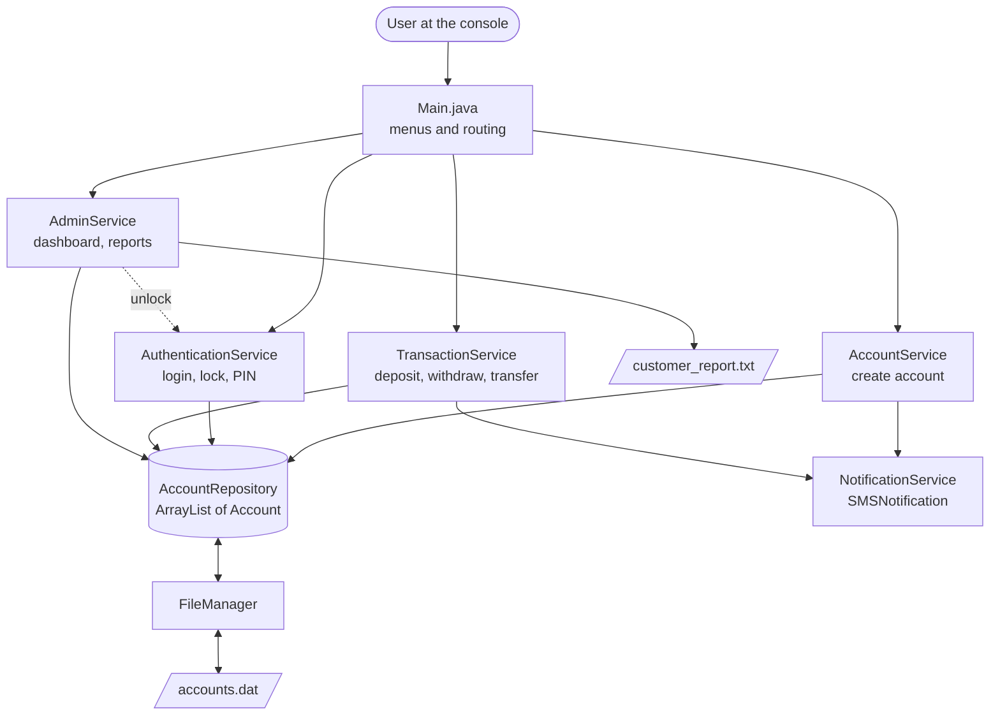

### 3.2 Menu flow

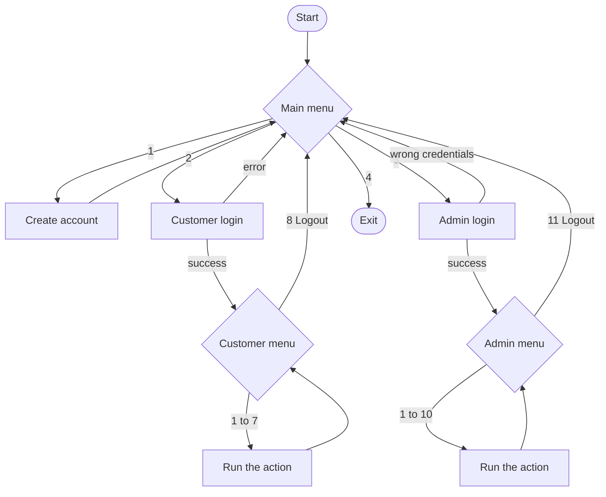

### 3.3 What happens on a deposit

This is the pattern every money operation follows: the service changes the objects in memory, then `Main` asks the repository to save.

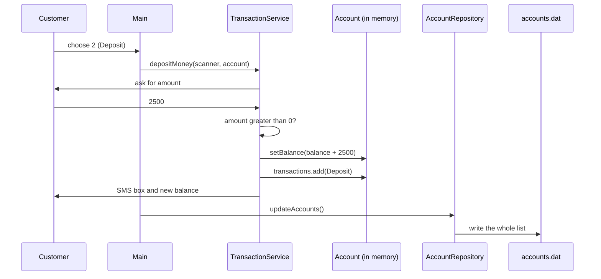

### 3.4 Login and locking

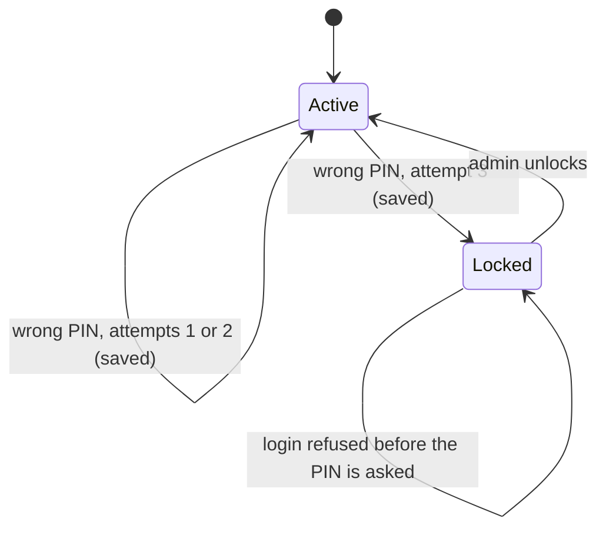

---

## 4. Technology stack

| Area | Choice | Why |
|---|---|---|
| Language | Java (author used JDK 25; any recent JDK works) | The point of the project is core Java |
| Build | None, plain `src` folder opened in IntelliJ IDEA | Nothing to configure |
| Dependencies | **None** | Only the standard library: `java.io`, `java.util`, `java.time` |
| Storage | Java object serialization to `accounts.dat` | No database needed |
| Report | `BufferedWriter` and `FileWriter` | Plain-text export |
| Version control | Git and GitHub | |

---

## 5. Project structure

```
BankingManagementSystem
│
├── src
│   ├── app
│   │   └── Main.java                    # Entry point: menus, routing, top-level error handling (146 lines)
│   │
│   ├── model                            # Domain objects, all Serializable
│   │   ├── Account.java                 # Abstract base: number, name, PIN, balance, lock state, transactions
│   │   ├── SavingsAccount.java          # Adds interestRate (5.0)
│   │   ├── CurrentAccount.java          # Adds overdraftLimit (100000)
│   │   └── Transaction.java             # One entry in the history: type, amount, time, remarks
│   │
│   ├── service                          # Business rules
│   │   ├── AccountService.java          # Create an account
│   │   ├── AuthenticationService.java   # Customer login, admin login, lock, unlock, change PIN, logout
│   │   ├── TransactionService.java      # Balance, deposit, withdraw, transfer, history, mini statement
│   │   └── AdminService.java            # Search, delete, sort, statistics, report, unlock
│   │
│   ├── repository
│   │   └── AccountRepository.java       # In-memory list of accounts and every query on it
│   │
│   ├── notification
│   │   ├── NotificationService.java     # Interface: sendNotification(String)
│   │   ├── SMSNotification.java         # Prints an SMS-style box (used)
│   │   └── EmailNotification.java       # Prints an email-style box (not wired in yet)
│   │
│   ├── util
│   │   ├── Menu.java                    # Prints the three menus
│   │   └── FileManager.java             # Loads and saves accounts.dat
│   │
│   ├── exception
│   │   ├── BankException.java           # Base class, extends Exception
│   │   ├── InvalidAmountException.java
│   │   ├── InvalidPinException.java
│   │   ├── AccountNotFoundException.java
│   │   ├── AccountAlreadyExistsException.java   # Defined, never thrown yet
│   │   ├── InsufficientBalanceException.java
│   │   └── SameAccountTransferException.java
│   │
│   ├── practice                         # Stand-alone file I/O and serialization exercises, not part of the app
│   │   ├── FileExample1.java, FileReaderExample1.java
│   │   ├── FileWriterExample1.java, FileWriterExample2.java, FileWriterExample3.java
│   │   ├── BufferedWriterExample1.java
│   │   └── SerializationDemo.java
│   │
│   └── screenshots                      # 12 PNGs used in this README
│
├── accounts.dat                         # Created at runtime (listed in .gitignore)
├── customer_report.txt                  # Created by "Export Customer Report" (listed in .gitignore)
├── BankingManagementSystem.iml          # IntelliJ module file (source folder: src)
├── .gitignore
└── README.md
```

> The `practice` package has its own `main` methods and is independent from the bank. It is where the file I/O and serialization techniques used by `FileManager` and `AdminService` were first tried.

---

## 6. Code in detail

### 6.1 Class relationships

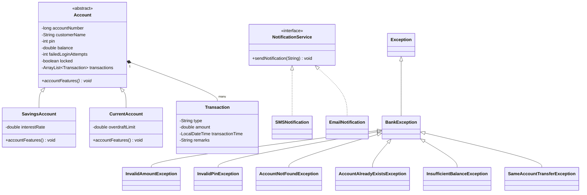

### 6.2 `app.Main`

The program's only entry point. It:

1. Creates a `Scanner` and **one** `AccountRepository` (which loads `accounts.dat`).
2. Creates the four services, each given that repository.
3. Runs three nested loops: the main menu, the customer menu (after login) and the admin menu (after admin login).
4. Calls `repository.updateAccounts()` after deposit, withdraw and transfer to write changes to disk.
5. Catches exceptions. Inside the customer and admin menus any `Exception` is caught and its message is printed; at the main-menu level a `BankException` is caught. That is how a wrong PIN or an unknown account returns you to a menu instead of ending the program.

### 6.3 Model

**`Account`** (abstract) holds everything every account has:

| Field | Meaning |
|---|---|
| `accountNumber` | `long`, 12 digits, generated by the repository |
| `customerName` | `String` |
| `pin` | `int`, 1000 to 9999 |
| `balance` | `double` |
| `failedLoginAttempts` | counts wrong PINs, reset on success |
| `locked` | `true` after 3 wrong PINs |
| `transactions` | `ArrayList<Transaction>`; the constructor adds the first "Deposit" entry for the opening balance |

It declares `abstract void accountFeatures()`, which each subclass must implement. That is the abstraction and polymorphism showcase: admin screens call `account.accountFeatures()` on any account and the right text prints.

**`SavingsAccount`** adds `interestRate = 5.0`; `accountFeatures()` prints `Interest Rate : 5.0%`.

**`CurrentAccount`** adds `overdraftLimit = 100000`; `accountFeatures()` prints `Overdraft Limit : 100000.0`.

**`Transaction`** is one history entry (type, amount, remarks and a `LocalDateTime` set when it is created). `getFormattedDateTime()` formats it as `yyyy-MM-dd HH:mm:ss a`, and `toString()` prints the boxed block you see in the history. Types used in the code: `Deposit`, `withdrawal`, `Transfer`, `Received`.

All model classes implement `Serializable` with `serialVersionUID = 1L`.

### 6.4 Repository: `AccountRepository`

Holds `ArrayList<Account> accounts`, loaded once in the constructor through `FileManager.loadAccounts()`.

| Method | Behaviour |
|---|---|
| `addAccount(account)` | Adds and saves immediately |
| `findByAccountNumber(n)` | Linear search, returns `null` if not found |
| `findByCustomerName(text)` | Case-insensitive "contains", returns a list |
| `getAccounts()` | Returns a **copy of the list**, but the `Account` objects inside are the same ones |
| `updateAccounts()` | Writes the whole list to disk |
| `deleteAccount(account)` | Removes and saves |
| `getTotalCustomers()`, `getTotalBalance()` | Aggregates |
| `generateUniqueAccountNumber()` | `100000000000 + random × 900000000000`, repeated until no account has that number |

> **Important detail.** Because `getAccounts()` and `findByAccountNumber()` return the real `Account` objects, a service can change a balance in memory without the repository noticing. That is why `Main` calls `updateAccounts()` after money operations and why a change is only safe once something saves it (see [Known issues](#13-known-issues-and-ideas-for-improvement), item 2).

### 6.5 Services

**`AccountService.createAccount(scanner)`**
Account type must be 1 or 2. The name cannot be empty. The PIN must be between 1000 and 9999. The initial deposit must be greater than zero. Then it builds a `SavingsAccount` or `CurrentAccount`, calls `repository.addAccount`, sends an SMS and prints the generated account number.

**`AuthenticationService`**

| Method | Behaviour |
|---|---|
| `login(scanner)` | Account must exist; a locked account is refused **before** the PIN is asked; a correct PIN resets the counter; a wrong PIN increments it and saves; the 3rd wrong PIN sets `locked = true` and saves |
| `adminLogin(scanner)` | Compares to a fixed username and password, returns `true` or `false` |
| `unlockAccount(scanner)` | Clears `locked` and the counter (called from the admin menu through `AdminService`) |
| `changePIN(scanner, account)` | Current PIN must match; new PIN must be 4 digits and different; saves |
| `logout(account)` | Prints a goodbye |

The limit is the constant `MAX_LOGIN_ATTEMPTS = 3`.

**`TransactionService`**

| Method | Rules |
|---|---|
| `checkBalance` | Prints the account details |
| `depositMoney` | Amount > 0, then adds a `Deposit` transaction and sends an SMS |
| `withdrawMoney` | Amount > 0 and ≤ balance, then adds a `withdrawal` transaction and sends an SMS |
| `transferMoney` | Receiver must exist and differ from the sender; amount > 0 and ≤ balance; debits one, credits the other, adds a `Transfer` entry to the sender and a `Received` entry to the receiver |
| `viewTransactionHistory` | Prints every transaction |
| `miniStatement(account, limit)` | Prints the last `limit` transactions (Main passes 5) |

**`AdminService`**

| Method | Behaviour |
|---|---|
| `displayAllAccounts` | Lists every account with its `accountFeatures()` line |
| `searchAccount` / `searchCustomerByName` | Exact number / partial name |
| `deleteAccount` | Removes after lookup, no confirmation prompt |
| `showTotalCustomers`, `showTotalBankBalance` | Totals |
| `sortAccounts` | Works on a copy of the list with a `Comparator` chosen from a sub-menu |
| `shoeBankStatistics` | One pass over all accounts for counts, total, average, highest, lowest and transaction total (the method name has a typo, see Known issues) |
| `exportCustomerReport` | Writes `customer_report.txt` with a `BufferedWriter` |
| `unlockAccount` | Delegates to `AuthenticationService` |

The sort options use these comparators:

```java
Comparator.comparingLong(Account::getAccountNumber)
Comparator.comparing(Account::getCustomerName, String.CASE_INSENSITIVE_ORDER)
Comparator.comparingDouble(Account::getBalance)            // and .reversed()
Comparator.comparing(a -> a.getClass().getSimpleName())
```

### 6.6 Notifications

`NotificationService` is an interface with one method. `SMSNotification` and `EmailNotification` both implement it and print a boxed message. `AccountService` and `TransactionService` create `new SMSNotification()` in their constructors, so only SMS boxes appear today. Switching to email is a one-line change in each service, which is the point of coding against an interface.

### 6.7 Exceptions

All custom exceptions extend `BankException`, which extends `Exception`, so they are **checked** exceptions: the compiler forces every method to either catch them or declare `throws`.

| Class | Thrown when |
|---|---|
| `BankException` | General rule broken (invalid account type, empty name, bad PIN format, locked account) |
| `InvalidAmountException` | Deposit, withdraw or transfer amount is zero or negative |
| `InvalidPinException` | Wrong PIN, wrong current PIN, or account locked by the 3rd wrong PIN |
| `AccountNotFoundException` | Login, unlock or transfer target does not exist |
| `InsufficientBalanceException` | Withdraw or transfer more than the balance |
| `SameAccountTransferException` | Transfer to your own account |
| `AccountAlreadyExistsException` | Defined for future use; nothing throws it today |

### 6.8 Utilities

- **`Menu`** only prints. The customer menu shows name, number, type and balance (`%.2f`) above the options.
- **`FileManager`** has two static methods, `loadAccounts()` and `saveAccounts(list)`, both using try-with-resources so the streams always close.

---

## 7. Data and persistence

### `accounts.dat`

The entire `ArrayList<Account>` is written with `ObjectOutputStream` **every time something is saved**, and read back with `ObjectInputStream` when the program starts. It is a binary file, so it cannot be read in a text editor.

| Situation | Result |
|---|---|
| File does not exist | Starts with an empty list (first run) |
| File exists | All accounts, with their transactions, are restored |
| File cannot be read | Prints `Unable to load accounts.` and starts empty |
| Write fails | Prints `Unable to save accounts.` |

The file is created **in the current working directory** of the program, so run the program from the same folder each time (IntelliJ uses the project folder by default).

Both `Account` and `Transaction` carry `serialVersionUID = 1L`. If you add or rename fields later, old files may fail to load; delete `accounts.dat` or write a migration.

### `customer_report.txt`

Overwritten on every export. Layout:

```
====================================================
                 BANK CUSTOMER REPORT
====================================================

Account Number: 789456123654
Customer Name: vinay
Account Type: CurrentAccount
Balance        : ₹6000.00
Transactions: 1
----------------------------------------------------
...
====================================================
                 END OF REPORT
====================================================
```

Both files are listed in `.gitignore`, so a fresh clone starts with no accounts. If they were committed before the ignore rule was added, remove them from Git's index with `git rm --cached accounts.dat customer_report.txt`.

---

## 8. Running it

### Requirements

- JDK 17 or newer (the author used JDK 25; I compiled and ran it on JDK 21)
- IntelliJ IDEA (recommended) or just a terminal

### In IntelliJ IDEA

1. **File → Open** and select the `BankingManagementSystem` folder. The `.iml` file already marks `src` as the source folder.
2. Set the Project SDK (File → Project Structure → Project) if IntelliJ asks.
3. Open `src/app/Main.java` and click the green ▶ next to `main`.

### From a terminal

Run these from the **project root** (the folder that contains `src`), so `accounts.dat` is created next to the project, the same place IntelliJ uses:

```bash
javac -encoding UTF-8 -d out -sourcepath src src/app/Main.java
java -cp out app.Main
```

`-sourcepath src` makes the compiler find every class `Main` uses, so there is no need to list packages. `-encoding UTF-8` keeps the `₹` sign intact.

> The previous README compiled from inside `src` and ran from there, which would put `accounts.dat` in `src/` and make it look like the data disappeared when switching between IntelliJ and the terminal.

### Demo admin login

```
Username: admin
Password: admin
```

Fixed demo credentials for learning use only (see [Security notes](#11-security-notes)).

---

## 9. Using the application (walkthrough)

### Main menu

```
BANKING MANAGEMENT SYSTEM
1. Create Customer Account
2. Customer Login
3. Admin Login
4. Exit
```

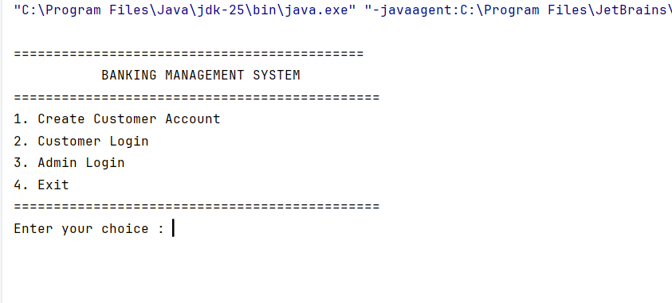

### Create an account

Choose **1**, pick Savings or Current, enter name, a 4-digit PIN and the opening deposit. The program prints the generated 12-digit account number. **Write it down: it is your login.**

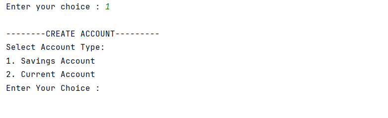
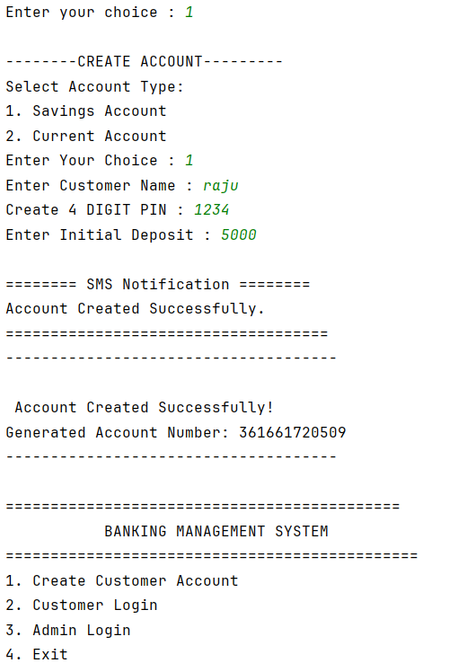

### Customer login and dashboard

Choose **2**, enter the account number and PIN. The dashboard shows your details and balance above the menu:

```
1. Check Balance     5. Transaction History
2. Deposit Money     6. Mini Statement
3. Withdraw Money    7. Change PIN
4. Transfer Money    8. Logout
```

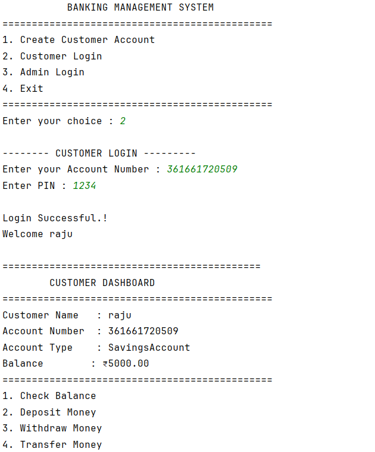
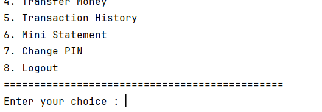
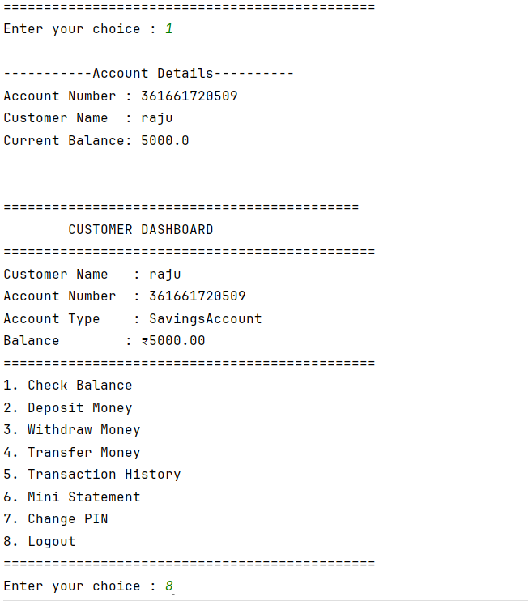

### Admin login and dashboard

Choose **3** and enter the admin credentials.

```
1. Display All Accounts        7. Sort Accounts
2. Search By Account Number    8. Bank Statistics
3. Search By Customer Name     9. Export Customer Report
4. Delete Account             10. Unlock Account
5. Total Customers            11. Logout
6. Total Bank Balance
```

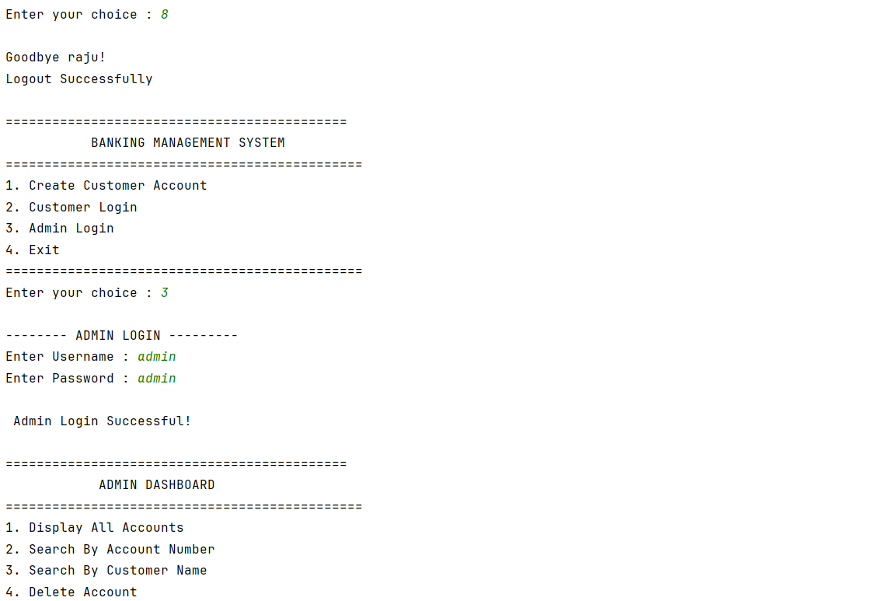
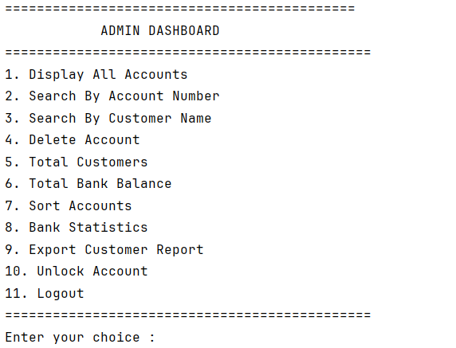

### Statistics and report

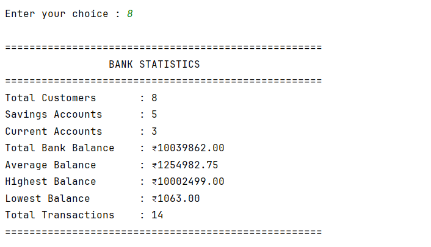
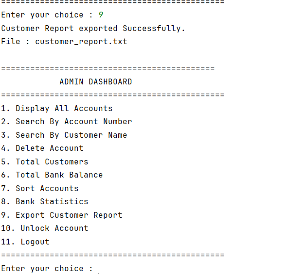

### Unlocking an account

After three wrong PINs the customer sees `ACCOUNT LOCKED`. The admin unlocks it with option **10**:

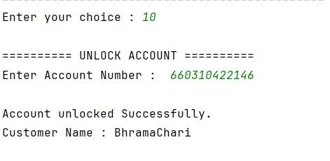

### Logging out

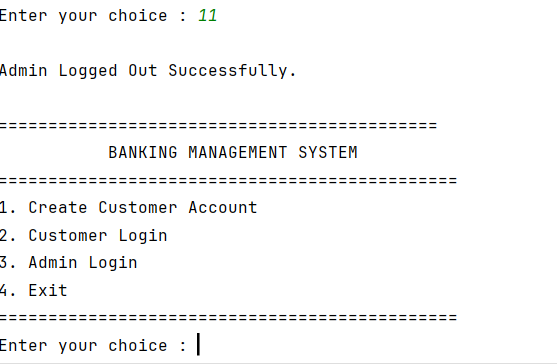

---

## 10. Testing

There are no automated tests yet. These are the manual checks that cover the rules, with the expected result. I ran the lock, unlock, relaunch and bad-input cases against the code while preparing this README.

| # | Action | Expected |
|---|---|---|
| 1 | Create an account with PIN `123` | `PIN must contain only 4 digits` |
| 2 | Create an account with an initial deposit of `0` | `Initial deposit must be greater than zero.` |
| 3 | Login with an unknown account number | `Account Number not found.` |
| 4 | Enter a wrong PIN once | `Incorrect PIN. Attempts Remaining 2` |
| 5 | Enter wrong PINs three times | `ACCOUNT LOCKED` box, then login is refused with `Your Account is locked` |
| 6 | Deposit `-50` | `Deposit Amount must be greater than 0!` |
| 7 | Withdraw more than the balance | `Insufficient Balance.` |
| 8 | Transfer to your own account number | `You cannot transfer money to your own Account.` |
| 9 | Transfer to an unknown number | `Receiver Account Not Found.` |
| 10 | Deposit, exit with option 4, start again, log in | Balance and history are still there |
| 11 | Admin option 9, then open `customer_report.txt` | One block per account |
| 12 | Wrong admin password | `Invalid Admin Credentials`, back to the main menu |

---

## 11. Security notes

This is a learning project; it should not hold real money or real people's data.

| Area | Current state |
|---|---|
| Admin credentials | Hard-coded in `AuthenticationService` as `admin` / `admin`, visible in the source |
| PIN storage | Stored as a plain `int` in `accounts.dat` and typed in clear text |
| Account lock | Works for customers (3 attempts). The admin login has **no** lockout |
| Data file | Not encrypted; anyone with the file can load it |
| Input | Numeric prompts are not fully guarded (see Known issues, item 1) |
| Secrets in the repo | None; the demo password above is the only credential and is intentionally public |

Before using the ideas in a real system: hash PINs and passwords (for example with BCrypt), move admin credentials out of the source, and store data in a database with proper access control.

---

## 12. Troubleshooting

| Symptom | Cause and fix |
|---|---|
| `Exception in thread "main" java.util.InputMismatchException` or `NoSuchElementException` | A letter was typed where a number is expected, or input ended. Restart and enter numbers only (see Known issues, item 1) |
| All accounts disappeared | The program was started from a different folder, so a new empty `accounts.dat` was created. Run from the project root |
| `Unable to load accounts.` at startup | `accounts.dat` is damaged or from an older version of the classes. Delete it and start again (accounts are lost) |
| `₹` shows as `?` or garbage | Console encoding. In IntelliJ set the run option `-Dfile.encoding=UTF-8`; compile with `-encoding UTF-8` |
| `javac: command not found` | JDK is not installed or not on `PATH`. Install a JDK and reopen the terminal |
| `error: class Main is public, should be declared in a file named` | You compiled from the wrong folder. Use the exact commands in [section 8](#8-running-it) |
| A locked customer cannot log in | Admin menu, option 10 (Unlock Account). Note the caveat in Known issues, item 2 |
| IntelliJ says "Project SDK is not defined" | File → Project Structure → Project → choose a JDK |

---

## 13. Known issues and ideas for improvement

### Known issues (found by reading and running the code)

| # | Issue | Where | Effect | Fix |
|---|---|---|---|---|
| 1 | Letters typed at a number prompt crash the program | `scanner.nextInt()` in `Main` (lines 28, 42, 87) and in the services; only `BankException` is caught at the main level | `InputMismatchException` ends the app. Anything not yet saved is lost | Read each line with `nextLine()` and parse it inside a `try/catch`, or catch `InputMismatchException` and call `scanner.nextLine()` to discard the bad token |
| 2 | **Unlocking is not saved** | `AuthenticationService.unlockAccount` (lines 110 to 113) never calls `repository.updateAccounts()` | If the admin unlocks an account and exits before any other save, the account is locked again on the next start. I reproduced this | Add `repository.updateAccounts();` after `setFailedLoginAttempts(0)` |
| 3 | Overdraft and interest are display only | `CurrentAccount.overdraftLimit`, `SavingsAccount.interestRate` | Withdrawals are capped at the balance, so the overdraft limit is never used, and no interest is ever added | Let `withdrawMoney` allow `balance + overdraftLimit` for current accounts; add a method that credits interest |
| 4 | `EmailNotification` is never used | `AccountService`, `TransactionService` hard-code `new SMSNotification()` | Only SMS boxes appear | Pass a `NotificationService` into the constructors from `Main` |
| 5 | `AccountAlreadyExistsException` is never thrown | `exception` package | Dead class | Throw it if you add a rule such as one account per name |
| 6 | Money is a `double` | `Account.balance`, `Transaction.amount` | Fractions can accumulate rounding error | Use `BigDecimal` |
| 7 | A damaged file is silently replaced | `FileManager.loadAccounts` returns an empty list on failure; the next save overwrites the file | Possible data loss | Back up the file before overwriting, or stop with an error |
| 8 | Whole file rewritten on every change | `FileManager.saveAccounts` | Fine for dozens of accounts, slow for thousands | Move to a database (see ideas) |
| 9 | `miniStatement` null check does not `return` | `TransactionService` lines 149 to 151 | Would throw `NullPointerException` for a null account (cannot happen from the menu today); the heading also says "Transaction History" | Add `return;` and change the heading |
| 10 | Small output glitch | `AdminService.displayAccounts` prints `Transactions : %d` without a new line | The count and the interest/overdraft line run together in the sort output | Use `%d%n` |
| 11 | Name and spelling slips | `shoeBankStatistics` (should be `showBankStatistics`); the opening-deposit remark reads `Intitial Deposit` | Cosmetic | Rename and fix the text |
| 12 | Delete has no confirmation | `AdminService.deleteAccount` | One wrong number removes an account | Ask "Are you sure?" |

### Ideas

- Replace file storage with **JDBC and MySQL** (`AccountRepository` is already the single place to change)
- Wrap the logic in a **Spring Boot REST API** and add a small web front end
- **Hash** PINs and admin credentials; add an admin lockout
- Add **JUnit 5** tests for the services (the repository can be handed a temporary file)
- Monthly interest for savings accounts and real overdraft for current accounts
- Real email or SMS through an external provider behind the existing `NotificationService` interface

---

## 14. Explaining the project in two minutes

**The pitch.**
"It's a console banking system in core Java. Customers create Savings or Current accounts, log in with a PIN that locks after three mistakes, and deposit, withdraw and transfer money. An admin can search, sort, unlock, delete accounts and export a report. Everything is saved with Java serialization, so it survives restarts."

**The structure.**
"I split it into layers. `Main` only shows menus and routes choices. The services hold the rules. One repository owns the list of accounts and is the only thing that talks to the file. The model has an abstract `Account` with `SavingsAccount` and `CurrentAccount` subclasses."

**Likely questions**

| Question | Answer |
|---|---|
| Where is OOP used? | Abstraction (`Account`, `NotificationService`), inheritance (`SavingsAccount`/`CurrentAccount`), polymorphism (`accountFeatures()` and the notification interface), encapsulation (private fields with getters and setters) |
| Why an abstract `Account`? | Both account types share everything except one behaviour, so the shared part lives once in the parent and each child supplies its own `accountFeatures()` |
| What is the repository pattern here? | One class hides how accounts are stored. Services ask it for accounts and never touch files, so storage can change without touching the rules |
| How are accounts saved? | The whole `ArrayList<Account>` is written with `ObjectOutputStream` after each change and read back with `ObjectInputStream` on startup. Classes implement `Serializable` |
| How does locking work? | Each account counts failed attempts. On the third wrong PIN `locked` becomes `true` and is saved. A locked account is refused before the PIN is even requested. The admin can unlock it |
| Why custom exceptions? | Each failure has a clear name and message, and the menu loops catch them so the program keeps running instead of crashing |
| How is the account number generated? | A random 12-digit number, regenerated until no existing account has it |
| What happens in a transfer? | Check receiver exists and is not yourself, check amount and balance, debit one account, credit the other, add a `Transfer` and a `Received` transaction, then save |
| What would you improve first? | Fix the unsaved-unlock bug and bad-input crash, hash the PINs, then move to a database. These are listed honestly in section 13 |
| Is `EmailNotification` used? | Not yet. The services use SMS; the interface makes switching a one-line change |

---

## 15. Author

**Adamu Alamuri**